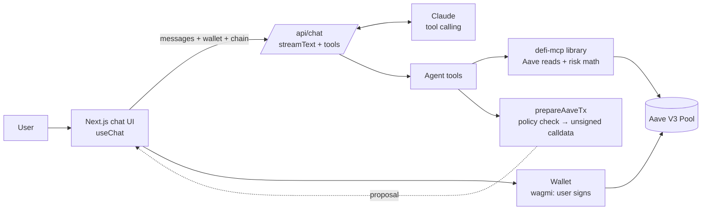

<div align="center">

# 🤖 DeFi Agent

**An AI agent for Aave V3 that explains your risk, simulates every move, and only ever *proposes* transactions — you sign.**


</div>

---

## What it does

> **You:** How risky is my position? Can I borrow 500 USDC more?
>
> **Agent:** *reads your Aave account → simulates the borrow →* Your health factor is **2.41**; ETH would need to fall **58%** before liquidation. Borrowing 500 USDC takes it to **1.87** — still comfortable. Want me to prepare it?
>
> **You:** Yes
>
> **Agent:** *prepares unsigned tx → card with "Review & sign" appears*

- 💬 **Plain-language risk** — health factor, liquidation distance per collateral, net APY.
- 🧪 **Simulate before acting** — every proposal shows health factor *before → after*.
- ✍️ **Human-in-the-loop by design** — the model never holds keys and never sends anything. It returns unsigned calldata; you review and sign each step in your own wallet.
- 🛡 **Policy guardrail in code, not in the prompt** — borrow/withdraw proposals that would drop the health factor below `MIN_HEALTH_FACTOR` (default 1.3) are refused server-side, whatever the model says.
- 🔗 **5 chains** — Base, Ethereum, Arbitrum, Optimism, Polygon.

## Architecture



| Tool | Purpose |
|---|---|
| `getMarkets` | Rates, LTV, liquidation thresholds, utilization |
| `getAccount` | Position, health factor, liquidation distance per collateral |
| `simulate` | What-if for a sequence of supply / withdraw / borrow / repay |
| `proposeTransaction` | Policy-checked unsigned tx (incl. ERC-20 approve if needed) |

On-chain reads and risk math come from **[defi-mcp](https://github.com/StanislavV01/defi-mcp)** — the same code that powers the MCP server, imported as a library. One source of truth for both Claude Desktop and this app.

### Design decisions

- **Guardrails live in code.** Prompts can be ignored; `prepareAaveTx` re-simulates and throws if the result is unsafe.
- **Agent context is server-side.** Transactions are only ever built for the connected wallet, never for an address the model makes up.
- **Typed tools with zod** — invalid model calls fail fast with a message the model can recover from.
- **Bounded loop** — `stopWhen: stepCountIs(8)` caps tool-call chains.

## Run locally

```bash
git clone https://github.com/StanislavV01/defi-agent && cd defi-agent
npm install
cp .env.example .env.local   # add ANTHROPIC_API_KEY
npm run dev
```

Open http://localhost:3000, connect MetaMask or Rabby, ask away.

| Variable | |
|---|---|
| `ANTHROPIC_API_KEY` | required |
| `MODEL` | Claude model id (default `claude-sonnet-5-5`) |
| `MIN_HEALTH_FACTOR` | safety floor for proposals (default `1.3`) |
| `RPC_URL_<CHAIN>` | your own RPCs (recommended) |

## Roadmap

- [ ] Evals: scripted conversations scored for correct tool use and refusals
- [ ] Fork-simulation of each proposal (anvil / Tenderly) before showing it
- [ ] Position alerts: "tell me when my HF drops below 1.5"
- [ ] eMode-aware simulation

## Disclaimer

Educational project. Not financial advice. Always read what your wallet asks you to sign.

## License

MIT © Stanislav Verbytskyi
